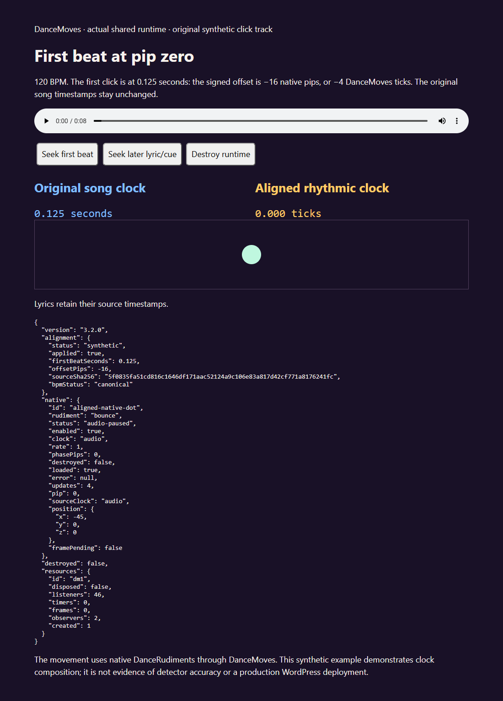

# Source-bound beat alignment



[Play the silent browser demonstration](videos/beat-alignment-browser.mp4).
The native bounce, playback pulse and two clock readings advance together;
the displayed lyric still follows its original source timestamp. These are
actual interface captures from an original synthetic 120 BPM click fixture,
with a first beat at 0.125 seconds and a -16 pip reading. The video preserves
the screenshot capture cadence; it is an interface demonstration rather than
frame-accurate musical performance evidence. [Capture provenance](beat-alignment-media.json).

WordPress **EPK Timing** has a **Beat alignment reading (StemLab JSON)** field
and **Analysed Master Audio** attachment selection. Generate the reading from
saved detector evidence with current StemLab:

```powershell
stemlab beat-offset RESULTS --output NEW-REPORT --audio EXACT-MASTER.mp3 `
  --alignment-analysis consensus --alignment-bpm-basis canonical
```

Use `combined_fit` when canonical BPM is unknown and the reviewed constant-grid
fit supports that choice. Review canonical, saved combined, half/same/double
interpretations and individual detectors first. A half-time result is a normal
metrical interpretation. Selecting a fitted tempo does not confirm canonical
BPM or first-downbeat authority.

Paste the exact `beat-alignment.json`, select its exact already public master
attachment and save through the existing site approval process. WordPress checks
the local attachment SHA-256, field bounds, numeric/rational consistency, source
frame bounds and BPM agreement before accepting the reading. Invalid input
preserves prior EPK timing fields; REST rejects it before content/meta writes.
Both new properties participate in revisions and the normal edit capability and
nonce protections. Unrecognized fields/private paths are omitted from public
configuration. No JSON upload permission or arbitrary filesystem path is added.

The attachment URL and normalized reading are localized as
`danceMovesConfig.beatAlignment`. The browser additionally checks exact rational
clock identity with BigInt. Native/master playback identity must match the
selected attachment URL before applying phase. An identified remote master may
supply `sourceUrl` in its verified master reference. Register a clip with the
existing `offset`, `duration`, `playerStart` and `masterVerified` mapping first.

`rhythmicTime(audio)` subtracts the first beat from the **mapped master time**;
`sourceTick(audio)` returns its fractional position at 16 ticks per beat. At the
first beat it is zero; before that it may be negative. This is the same as adding
the signed 64-pip offset and dividing by four. No integer rounding is introduced.
Core audio interval scheduling, procedural rudiments, playback pulses and sprite
cycles share this clock. Page-only clocks retain their own elapsed time.

```js
const state = runtime.beatAlignmentState(master);
// applied, status, firstBeatSeconds, offsetPips, sourceSha256, bpmStatus
const ticks = runtime.sourceTick(master); // also works during paused seek review
```

The audio, transport `currentTime`, lyric/cue timestamps and captured recording
sample clocks remain in original song time. The native frame's `sourceBeats`
remains the mapped source position for recorded movement; `rhythmicBeats`
exposes the aligned procedural position separately. Existing explicit sprite
phase offsets are additional choreography; audit them before migrating a page which
already compensates manually, to avoid applying the same phase twice.

Blank metadata means unverified phase. A hash mismatch is not a zero-offset
confirmation. Estimated phase stays estimated; an analysis-derived working BPM
has `bpmSource: 'analysis'`, separate from artist-confirmed canonical metadata.
An explicit stored BPM must agree with the selected reading (within its existing
three-decimal storage precision); the reading's full tempo precision is used.
A single page reading applies to its exact master only. Distinct tracks need
their own verified source association and scope; a title or equal duration is
insufficient. A constant grid is not proof of variable-tempo or whole-song fit.

Software publication does not deploy the WordPress plugin or change any EPK.
After approved deployment/save, verify installed/served version, fresh selected
metadata, exact hosted lyric/cue bytes, parser bounds, actual consumers, seek and
player switching, responsive output and preserved motion/accessibility controls.
