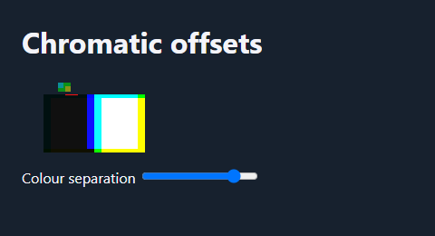

# Chromatic channel offsets

DanceMoves 3.8 adds an opt-in filter for artwork and sprite layers. Apply the
filter to selected elements and keep captions, controls and navigation outside
those elements. Each channel accepts a horizontal and vertical offset in CSS
pixels. Values are bounded to ±12 px and omitted channels stay at zero.

```html
<style>
  .artwork, .sprite {
    filter: var(--dance-moves-chromatic-filter, none);
  }
</style>
```

```js
await runtime.ready;
const colour = runtime.effects.chromaticOffset({ id: "artwork-rgb", root });
const phone = runtime.connectPhoneMotion({
  render: ({x, y}) => colour.set({
    red: [6 * x, 5 * y],
    blue: [-6 * x, -5 * y],
  }),
});
// When removing the experience:
phone.destroy();
colour.teardown();
```

A zero offset, reset, hidden document, reduced-motion preference or forced
colours restores the previous property value. Teardown also removes the filter.
The effect owns no sensor or animation loop. Feed it from the existing phone
motion, pointer or playback callback. Set the optional CSS custom property
name if two effects need separate appearance variables on the same root.

This follows FrameRudiments' independent RGB sampling and source-alpha masking
in a live SVG filter. Work is limited to the elements that use the property.
For busy scenes, keep the filtered surfaces small and measure the complete
effect stack on the target device.
[FrameRudiments channel displacement reference](https://github.com/kieransimkin/FrameRudiments/blob/v0.4.25/src/framerudiments/effect_graph.py#L871).



[Interactive browser example](../examples/chromatic-offset.html).
Run it from a local web server after building the package. The slider updates
the same filter used in the WordPress and plain browser pixel tests.

